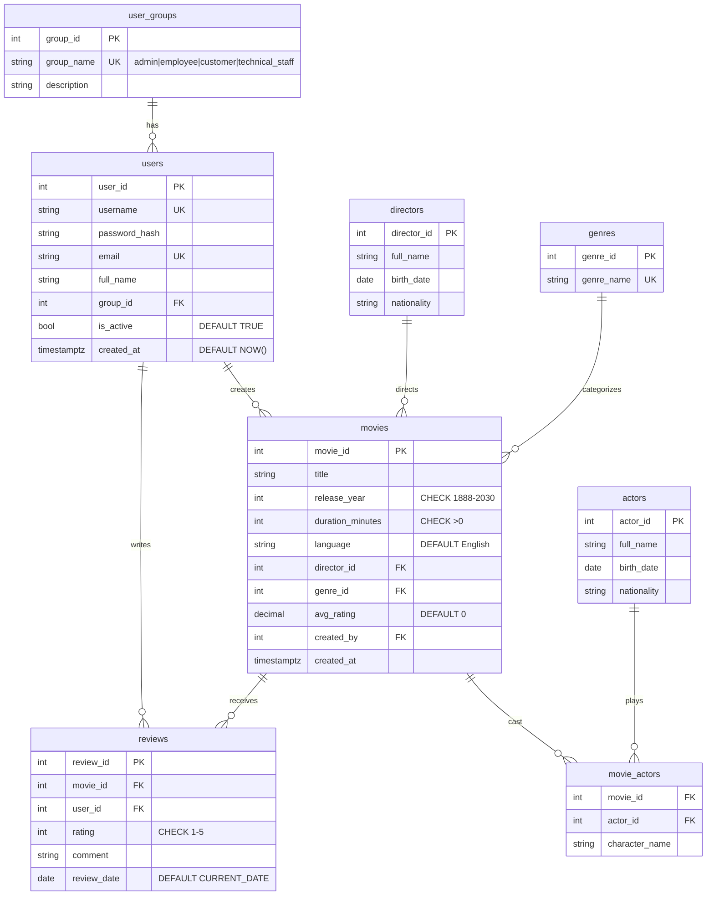

# ER Diagram - Movie_DB_App

## Tables (8, exceeds 6-table minimum)

```
user_groups ||--o{ users : "1 group has many users"
users ||--o{ movies : "1 employee creates many movies"
users ||--o{ reviews : "1 customer writes many reviews"
directors ||--o{ movies : "1 director directs many movies"
genres ||--o{ movies : "1 genre has many movies"
movies ||--o{ movie_actors : "1 movie has many cast rows"
actors ||--o{ movie_actors : "1 actor plays in many movies"
movies ||--o{ reviews : "1 movie has many reviews"
```

## Mermaid (paste into https://dbdiagram.io or Mermaid Live, screenshot for report)



## Relational notes for report

- PK: all `*_id` with SERIAL auto-increment, except `movie_actors` composite PK `(movie_id, actor_id)`
- FK: `users.group_id -> user_groups`, `movies.director_id/genre_id/created_by`, junction + reviews with `ON DELETE CASCADE` (except users.group and movies.director use SET NULL / RESTRICT)
- Constraints: UNIQUE on username/email/group_name/genre_name + (movie_id,user_id) in reviews; NOT NULL on titles/names; CHECK on email pattern, year, duration, rating; DEFAULT on booleans, dates, language, avg_rating
- Indexes on FK + title for JOIN/search speed

Screenshot instruction: import mermaid above into draw.io / dbdiagram.io, export PNG, save as `docs/erd.png` and paste into report Section 2.
